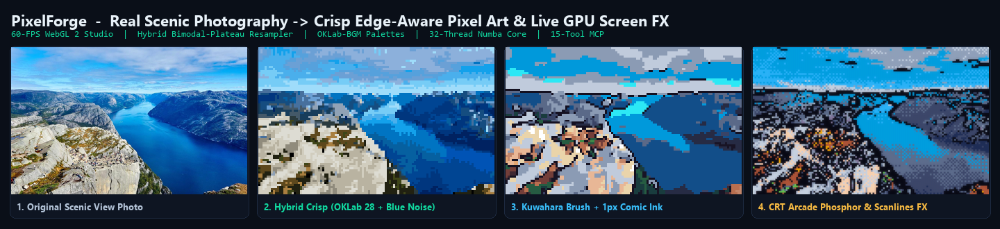
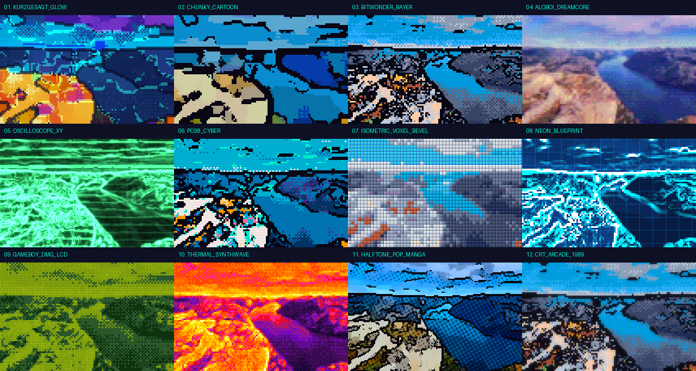
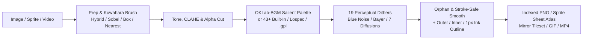

# PixelForge

**Hybrid Edge-Aware Pixel Art Studio, 32-Thread Numba Python Core, Game-Asset Pipeline & 15-Tool MCP Engine**



**PixelForge** turns images, sprite animations, and full-motion video into crisp, production-ready pixel art—running both in the browser at **60 FPS on WebGL 2** and headlessly in Python at **160+ FPS on multi-core Numba JIT** (plus a **15-tool Model Context Protocol server** for AI agents).

---

## Key Capabilities

- **4-Column PixelForge Workstation (`/editor/`) & Interactive Algorithm Lab (`/playground/`)**:
  - **5 Live Multi-Viewport Modes**: `Single (1)`, `Vertical/Horizontal Split Curtain (2/C)`, `Dual Sync Side-by-Side (3)`, `4-Up Snapshot/Preset Arena (4)`, and `3×3 Seamless Tile Wrap Checker (5)`.
  - **7 Non-Destructive Pixel Retouch Tools**: `Navigate/Pan (V)`, `Pixel Pencil 1–4px (B)`, `Procedural-Restore Pixel Eraser (E)`, `Flood Bucket & Shift+Click Global Color Swap (K)`, `1px Bresenham Line (U)`, `1px Pixel Rectangle (R)`, and `Smart Eyedropper (I)`—composited non-destructively over the live WebGL 2 shader output with independent stroke undo/redo.
  - **Scientific Color & Game-Asset Telemetry**: Floating **12× Pixel Loupe Magnifier (`L`)** with `(X, Y)`, `#HEX`, and perceptual `OKLab` coordinates; live **RGB + Luminance Canvas Histogram**; **4 Style Snapshot Slots (`A/B/C/D`)**; built-in **Procedural OKLab Harmony Ramp Generator**; and a **Live Mirror-Deduplicated Tileset Preview Studio & VRAM Savings Calculator**.
  - **Interactive WebGL 2 Lab (`/playground/`)**: 4 live browser labs comparing `Bayesian Posterior` vs `64×64 Blue Noise` vs `Bayer 8×8` vs `Atkinson`, `OKLab-BGM` vs `Salient` vs `Median-Cut`, mirror-deduplicated tilemaps, and procedural OKLab color ramps.
- **Hybrid Bimodal-Plateau Downsampler (`hybrid`)**:
  - Uses smooth alpha-premultiplied box averaging in low-contrast gradients and skies (zero sensor/starfield noise) while splitting high-contrast edges around the tile midpoint into foreground/background plateaus weighted by inverse gradient—snapping typography, thin strokes, and sprite silhouettes cleanly without muddy anti-aliasing halos.
  - Also includes **`sobel`** (gradient-salient pooling), **`box`** (16×16 supersampled average), **`nearest`** (center-texel), and **automatic pixel-grid GCD detection** (`detect_pixel_grid`) to recover exact 1× native art from already-upscaled sprites.
- **Regularized OKLab-BGM Palette Discovery (`oklab-bgm` / `hybrid_bgm_oklab`) & Harmony Synthesis**:
  - Runs 7 regularized **Bayesian Gaussian Mixture EM** iterations in perceptual **OKLab** space (fitting anisotropic diagonal covariances + Dirichlet mixture priors) seeded by chroma- and edge-weighted **k-means++ / Median-Cut**—preserving tiny vivid neon highlights across WebGL 2 and Python with zero temporal flicker.
  - Includes **`generateHarmonyRamp`** for procedural cool-shadow / warm-highlight pixel-art color ramps, **43+ built-in palettes**, `.gpl` / `.pal` / `.hex` / `.txt` / `.json` I/O, and live **`lospec:<slug>`** fetching.
- **20 Perceptual Dithering Modes (WebGL 2 + CPU Parity)**:
  - **WebGL 2 & CPU Bayesian Posterior Soft Dither (`posterior` / `bgm_posterior`)**: Evaluates exact perceptual distances `(d₁, d₂)` to the 2 nearest OKLab centroids and thresholds Boltzmann posterior probability `P(c₁)` over a 64×64 void-and-cluster Blue Noise field—guaranteeing zero 3rd-color bleed and seam-free Voronoi transitions.
  - **Ordered & Halftone**: **64×64 Void-and-Cluster Blue Noise** (`bluenoise`), `bayer2`, `bayer4`, `bayer8`, `bayer16`, `cluster4` & `cluster8` halftone screens, `lines`, and arbitrary `custom` threshold matrices.
  - **7 Serpentine Error-Diffusion Kernels**: `floyd-steinberg`, `atkinson`, `sierra-lite`, `sierra`, `burkes`, `jarvis`, and `stucki`.
- **SVD Low-Rank Denoise, Kuwahara Brush, Local CLAHE Contrast & 1px Comic Ink**:
  - Dedicated **SVD / Low-Rank Structural Noise Pre-Filter** (`adjust.svd`: `0..1`), edge-preserving **Kuwahara flat-paint pre-brush** (`0..4`), 5×5 adaptive **CLAHE local micro-contrast** punch, luminance-preserving tone controls, orphan stray-pixel removal, stroke-preserving 3×3 majority smoothing, and 1px outlines (**`outer`**, **`inner`**, and internal **`ink`** comic contours).
- **Real-Time 60-FPS WebGL 2 Screen Post-FX, 20 Categorized Studio Presets & 12 Procedural Styles**:
  - Live WebGL 2 + CPU-parity **Screen & Stylization Post-FX** stage (`fx.mode`): **Bioluminescent Bloom**, **CRT Arcade Phosphor**, **3D Voxel Bevel**, **Handheld Dot-Matrix LCD**, **Oscilloscope P31 Vector Beam**, and **Cyber Blueprint Wireframe**, plus continuous **CRT Scanlines** and **RGB Chromatic Aberration** (`0..3 px`).
  - Ships with **20 categorized Studio presets** (`bgm-posterior`, `svd-cel`, `hybrid-crisp`, `kurzgesagt`, `crt-arcade`, `chunky-ink`, `pc98-cyber`, `voxel-3d`, `oscilloscope-xy`, `cyber-blueprint`, `aloboi-dream`, `pico-8`, `game-boy`, `one-bit`, `faithful`, `balanced`, `sprite`, `cga`, `newsprint`, `soft`), 4 bundled real scenic view photographs, and 12 Python procedural video/reel styles.
- **Game-Ready Asset & Video Exporters**:
  - **True 1/2/4/8-bit Indexed-Color PNG (`PLTE` + `tRNS`)** (~53% smaller files), 1px pixel-grid overlays, **Sprite Sheet Packer + TexturePacker/Aseprite JSON Atlas**, **Mirror-Deduplicated (`X/Y/XY` flip) Tileset & Tilemap Builder**, animated GIF, WebM, and H.264 MP4 (with audio pass-through or external `.wav` soundtrack muxing).
- **Computer-Vision Video Event & Motion Detectors**:
  - Built-in optical-flow motion energy, scene-cut detection, consonant camera-zoom interval extraction, 1D horizontal/vertical progress-bar fill curve tracking (`bar_fills`), progressive circle/contour/callout stroke drawing detection (`stroke_draws`), and audio-beat camera synchronization (`sync_video_motion_to_audio`).

---

## 12 Built-In Presets Showcase



---

## Architecture Overview



---

## Installation

### Python Engine, CLI & MCP Server

Requires Python 3.10+ (`numpy`, `scipy`, `scikit-learn`, `numba`, `Pillow`, `imageio`, `imageio-ffmpeg`):

```bash
pip install -e .
```

### Real-Time WebGL 2 Browser Studio & JS/TS Library

Requires Node.js 18+:

```bash
npm install
npm run build:site
npm run preview      # Launches Studio at http://localhost:8080/editor/
```

---

## Usage

### 1. Real-Time WebGL 2 Studio

Launch the browser studio either from Python or npm:

```bash
python -m pixelforge studio --port 8765
# Open http://localhost:8765/editor/
```

### 2. Command-Line Interface (`pixelforge`)

```bash
# List all presets, styles, built-in palettes, and dithering methods
python -m pixelforge catalog

# Convert an image using a preset or custom pipeline flags
python -m pixelforge convert input.png output.png --preset kurzgesagt-pixel --upscale 4
python -m pixelforge convert input.png inked.png --width 160 --resample hybrid --kuwahara 2 --palette 24 --dither bluenoise --outline ink --orphans

# Convert a video with locked temporal palette (and optional external WAV soundtrack)
python -m pixelforge convert clip.mp4 pixel_clip.mp4 --preset pc98-cyber-dither --upscale 4 --audio soundtrack.wav

# Pack animation frames into a Sprite Sheet PNG + TexturePacker JSON Atlas
python -m pixelforge spritesheet run_0.png run_1.png run_2.png run_3.png -o character_sheet.png --width 64 --outline outer

# Slice & mirror-deduplicate a level mockup into a Tileset PNG + JSON Tilemap
python -m pixelforge tileset mockup.png -o level_tileset.png --tile-size 16
```

### 3. Python API

```python
import imageio.v3 as iio
from pixelforge import PixelForge, save_png, pack_sprite_sheet, build_tileset

img = iio.imread("illustration.png")

engine = PixelForge(
    width=160,
    resample="hybrid",          # Bimodal-Plateau + Box edge-crisp downsampler
    kuwahara=2,                 # Flat-paint cartoon pre-brush
    palette=24,                 # Deterministic Salient OKLab-BGM extraction
    dither="bluenoise",         # 64x64 Void-and-Cluster Blue Noise
    dither_strength=0.42,
    remove_orphans=True,
    outline_mode="ink",         # 1px internal comic contour outlines
    outline_color="#100c1c",
)

pixel_1x = engine.fit_transform(img)
save_png("illustration_pixel.png", pixel_1x, scale=4, indexed=True)  # True Indexed PLTE+tRNS PNG
```

### 4. JavaScript / TypeScript WebGL 2 & CPU Engine

```js
import { createPixelator } from 'pixelforge';

const px = await createPixelator(); // WebGL 2 GPU pipeline with automatic CPU fallback
const result = await px.process(imageElementOrBuffer, {
  size: { width: 160, resample: 'hybrid' },
  adjust: { kuwahara: 2, contrast: 0.1, saturation: 0.14 },
  palette: { source: 'extract', count: 24, distance: 'oklab' },
  dither: { method: 'bluenoise', strength: 0.42 },
  cleanup: { orphans: true, smooth: false },
  outline: { mode: 'ink', color: '#100c1c' },
});

document.body.append(result.toCanvas(4));          // 4x nearest-neighbor canvas
const blob = await result.toBlob({ scale: 4 });    // Compact Indexed-Color PNG
```

---

## 15-Tool Model Context Protocol (MCP) Server

Start the headless JSON-RPC 2.0 stdio MCP server for Claude Desktop, Cursor, or custom AI agents:

```json
{
  "mcpServers": {
    "pixelforge": {
      "command": "python",
      "args": ["-m", "pixelforge.mcp_server"]
    }
  }
}
```

| Tool Name | Purpose |
| :--- | :--- |
| `catalog_list` | Lists all 14 presets, 12 procedural styles, 43+ palettes, 19 dithers, 4 resamplers, and 4 outline modes. |
| `image_convert` | Full pixel-art pipeline with Kuwahara brush, 19 dithers, outlines, pixel grid, and Indexed `PLTE` PNG export. |
| `image_stylize_reel` | Applies any of the 12 procedural styles (`kurzgesagt_glow`, `pc98_cyber`, `oscilloscope_xy`, etc.) + cleanup/outlines. |
| `image_showcase` | Renders a labeled 12-panel contact sheet comparing presets or procedural styles on an input image. |
| `image_detect_grid` | Detects the pixel block factor of upscaled pixel art via border-difference GCD and recovers 1× native art. |
| `palette_tool` | Extracts `hybrid_bgm_oklab` / `oklab_median_cut` palettes, fetches `lospec:<slug>`, or converts `.gpl`/`.pal`/`.hex`/`.json`. |
| `export_spritesheet` | Packs images or video frames into a Sprite Sheet PNG + TexturePacker/Aseprite JSON Atlas. |
| `export_tileset` | Slices pixel art into an `N×N` mirror-deduplicated (`X/Y/XY` flip) Tileset PNG + JSON Tilemap. |
| `video_convert` | Converts MP4/GIF video with locked temporal palette (zero flicker) and audio pass-through or WAV muxing. |
| `video_analyze_motion` | Extracts optical-flow motion energy, scene cuts, and consonant camera-zoom intervals (`±5, ±7, ±12`). |
| `video_detect_bar_fills` | Detects 1D horizontal & vertical progress-bar/meter fill curves (`[0.0 .. 1.0]`). |
| `video_detect_stroke_draws` | Standalone detector for progressive circle, contour-outline, and callout-line drawings (`start_s` to `finish_s`). |
| `video_extract_sound_triggers` | Extracts generalized visual-to-audio event triggers and arrangement regimes from video footage. |
| `video_sync_motion_to_audio` | Beat-locks camera micro-zooms and pan curves to an external `.wav` soundtrack prior to pixelization. |
| `trigger_catalog_list` | Returns the universal visual-to-sound trigger catalog schema. |

---

## Testing

```bash
# Python core, exporters, CV detectors & live stdio MCP handshake tests
python -m unittest tests/test_pixelforge.py -v

# Build JS bundles & static WebGL 2 Studio site
npm run build:site
```

## License

MIT License — see [LICENSE](./LICENSE).
